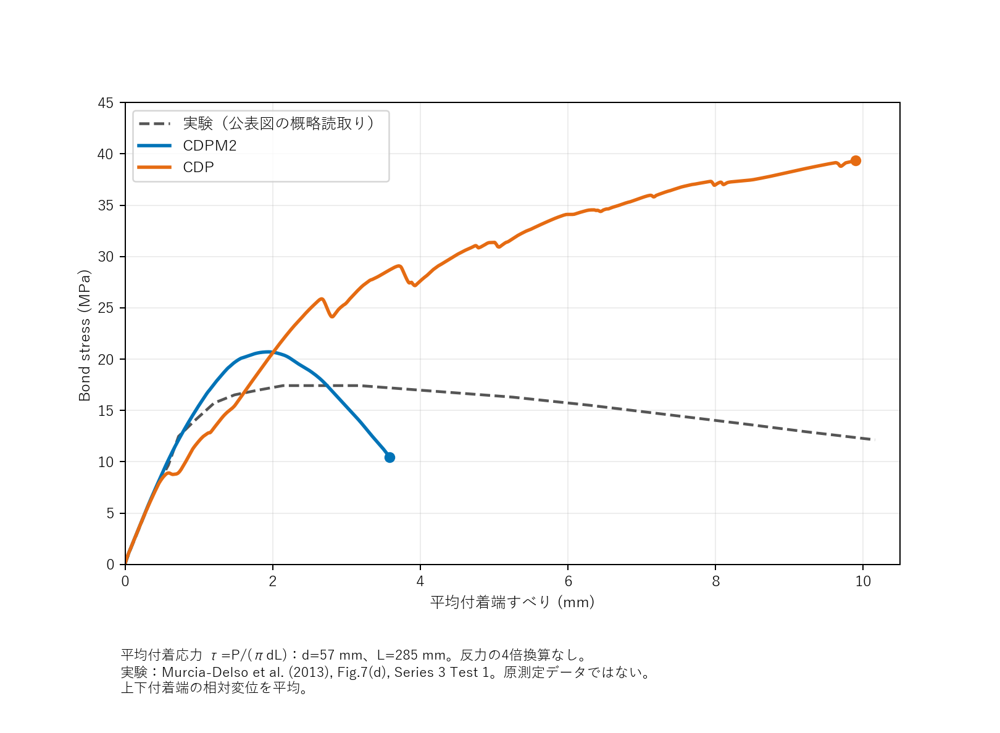

# Example 2: reinforced-bar pullout

## Complete illustrated guide / 図入り資料

[例題1・例題2 日本語PDF](examples/pullout/CDPM2_Examples_JA.pdf) /
[Examples 1 and 2 English PDF](examples/pullout/CDPM2_Examples_EN.pdf)

例題2は合冊版の7～11ページです。例題1と同じ8節構成で、モデル・材料・接触と解析制御・
曲線と結果・断面コンター・入力と実行方法・出典をまとめています。

## Model and setup

- Full 3D concrete cylinder: diameter 914 mm, height 855 mm.
- Main bar: diameter 57 mm, total length 1055 mm; bonded region Z=285-570 mm.
- Equivalent ring ribs: height 2.85 mm, base 7.10 mm, crown 1.40 mm, pitch 31.50 mm.
- Spiral: diameter 13 mm, outer diameter 813 mm, pitch 61 mm, 13 turns; embedded in concrete.
- Mesh: 421,248 elements and 441,295 nodes; C3D8R solids and T3D2 spiral.
- Concrete top face U3=0; loaded bar end U1=U2=0, prescribed positive U3.
- Three top-perimeter tangential constraints suppress in-plane rigid-body modes.
- Bar-concrete surface contact in bonded region; friction coefficient 0.5.
- Concrete E=27,600 MPa, nu=0.2; CDPM2 fc=34.5 MPa, ft=3.5 MPa, As=5.
- CDPM2 viscosity 0.001; CDP viscosity 0.0001, dilation 30 degrees, eccentricity 0.1.
- Static NLGEOM/UNSYMM; initial/minimum/maximum increments 0.001/1e-6/1.0.
- Monotonic 20 mm over time 10; CDP additional ramp to 40 mm over another time 10.
- See [input hashes and mesh counts](evidence/case2_model_summary.json) for traceability.

## 日本語での要約

直径57 mm・付着長285 mmの鉄筋引抜き解析について、CDPM2とCDPの保存結果を
比較します。縦軸は反力合計をπ×57×285で除した付着応力、横軸は上下の
測定断面における鉄筋―コンクリート相対変位の平均です。載荷点変位ではなく、
実験の変位計と厳密に同じ測定定義だと確認したものでもありません。

掲載範囲の最終値は、2-1の平均すべりが3.58574 mm、
付着応力は10.43685 MPa、2-2は9.90195 mm、39.34226 MPaです。
掲載する載荷点変位の範囲は下表に示します。

鉄筋曲線は実測値ではなく、公称降伏強度546 MPa・引張強度806 MPaとした仮定です。
表の範囲を超えた後は最終真応力一定で、破断モデルを含みません。
図の実験破線は公表図の概略読取りで、原測定データではありません。

## Results and scope

Example 2 compares CDPM2 and CDP using the displacement ranges listed below.

Bond stress is total pullout reaction divided by pi × 57 mm × 285 mm.
No factor of four is applied to the summed reaction. The horizontal axis is the
mean of the upper and lower bar-to-concrete relative displacements at the
defined measurement sections, not prescribed actuator displacement. This does
not assert exact equivalence to an experimental sensor definition.

| Case | Last plotted actuator displacement | Mean slip | Bond stress |
|---|---:|---:|---:|
| 2-1 CDPM2 | 4.06119 mm | 3.58574 mm | 10.43685 MPa |
| 2-2 CDP | 36.55268 mm | 9.90195 mm | 39.34226 MPa |

The CDPM2 peak is 20.71192 MPa at mean slip 1.94394 mm.

Steel is an assumed JSCE-based curve scaled to nominal fy=546 MPa, fu=806 MPa,
E=200000 MPa, nu=0.3, for both main bar and spiral. It is not a measured
specimen curve. Beyond plastic strain 0.1012083347 the tabulated final true stress
is held constant; no rupture model is used. The last available CDP field output
has bar PEEQ about 0.08613, spiral 0; it precedes the final history increment.
Do not interpret this as a final-increment field value or reproduced rupture.

This example is a numerical comparison, not proof of experimental pullout
failure reproduction. The independently drawn plot includes an approximate
visual reading of Murcia-Delso et al. (2013), Fig. 7(d), Series 3 Test 1, as
explicitly labelled in the figure. That dashed curve is not original measured
data, and is not a precise sensor-definition match. No original third-party
paper images or measured datasets are redistributed.
